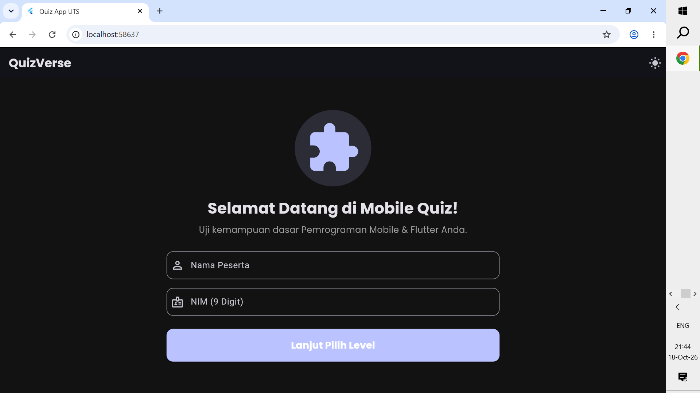
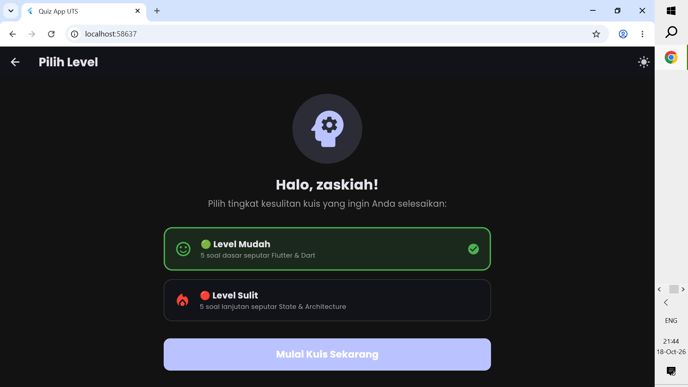
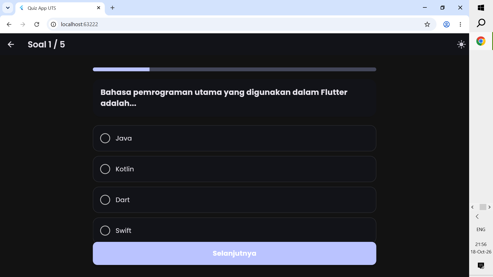
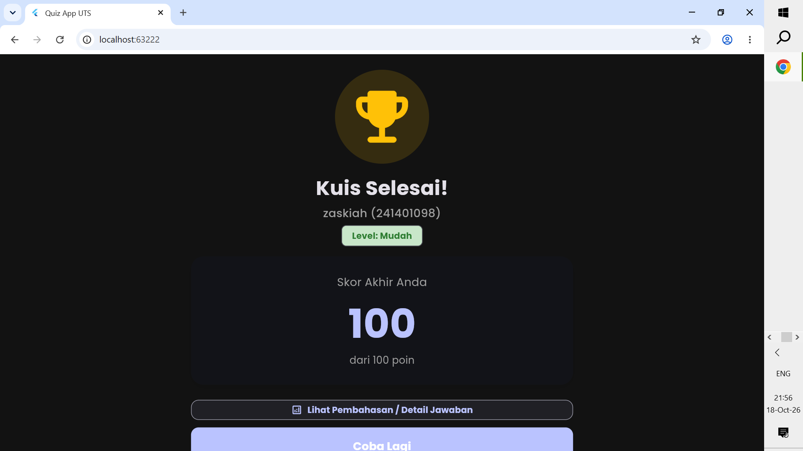
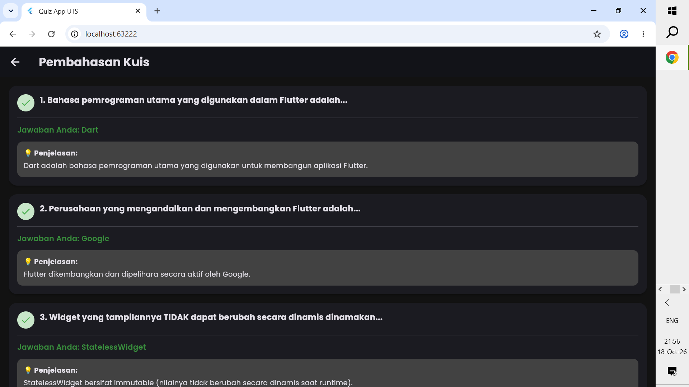

# UTS Lab Pemrograman Mobile - Aplikasi Kuis Pilihan Ganda

## Identitas Mahasiswa
- **Nama**: Zaskiah Angreani
- **NIM**: 241401098
- **Lab**: Lab Pemrograman Mobile 4

---

## Informasi Aplikasi
- **Nama Aplikasi**: QuizVerse
- **Deskripsi Singkat**:
  QuizVerse adalah aplikasi kuis interaktif berbasis Flutter yang dirancang untuk menguji pemahaman dasar hingga tingkat lanjut mengenai pengembangan aplikasi mobile dan framework Flutter. Aplikasi ini dilengkapi dengan validasi identitas peserta, alur pemilihan tingkat kesulitan soal, indikator progres, pembahasan jawaban, serta opsi mode tampilan (Light/Dark Mode) yang responsif di berbagai ukuran layar.

- **Fitur-Fitur Terpopuler & Utama**:
    1. **Validasi Input Identitas**: Form input Nama dan NIM dengan aturan validasi (NIM wajib berisi tepat 9 digit angka).
    2. **Pilihan Tingkat Kesulitan (Leveling)**: Halaman terpisah untuk memilih kategori kuis (🟢 Level Mudah dan 🔴 Level Sulit).
    3. **Kuis Interaktif & Progress Bar**: Indikator progres real-time, visualisasi kartu pilihan jawaban yang menonjol, dan notifikasi konfirmasi jawaban tersimpan (SnackBar).
    4. **Navigasi Soal Fleksibel**: Bebas berpindah ke soal sebelumnya (tombol *Kembali*) maupun ke soal berikutnya (*Selanjutnya*) tanpa kehilangan jawaban yang telah dipilih.
    5. **Kalkulasi Skor Otomatis & Identitas Peserta**: Menampilkan skor akhir secara transparan bersama nama dan NIM peserta pada kartu hasil.
    6. **Pembahasan Jawaban Lengkap (Review Screen)**: Fitur peninjauan kuis yang memperlihatkan status benar/salah, jawaban pengguna, jawaban yang benar, serta penjelasan rinci di tiap soal.
    7. **State Management berbasis Provider**: Seluruh state (progres kuis, mode tema, dan jawaban) tersimpan aman menggunakan paket `provider` sehingga tidak hilang saat terjadi rotasi layar.
    8. **Dual-Theme Mode & Responsive Layout**: Mendukung pengubahan tema (Light/Dark Mode) serta tata letak adaptif (MediaQuery & BoxConstraints) yang rapi di smartphone, tablet, maupun web browser.

---

## Dokumentasi

### 1. Credit Aset
- **UI Icons**: Material Icons bawaan Flutter
- **Font Kustom**: Google Fonts (`Poppins`) via paket `google_fonts`
- **State Management**: Provider via paket `provider`

### 2. Screenshot Tiap Page Aplikasi

| Halaman Welcome & Identitas | Halaman Pilih Level |
| :---: | :---: |
|  |  |

| Halaman Soal Kuis | Halaman Skor Akhir | Halaman Pembahasan |
| :---: | :---: | :---: |
|  |  |  |